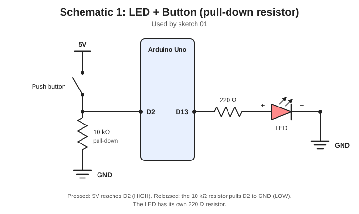
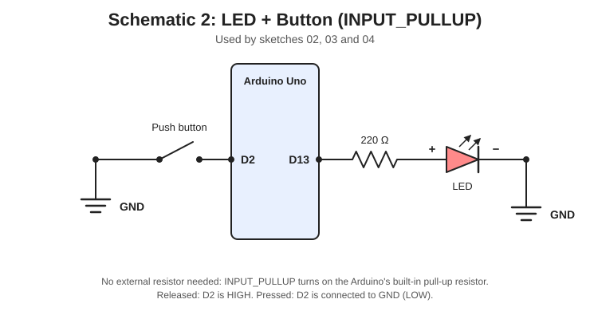
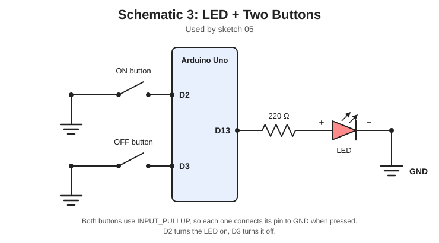
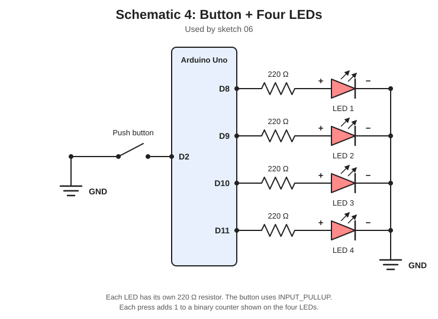

# Project 02: LED + Button

In Project 01 the Arduino only *sent* signals out. Now it will *listen*. You'll read a push button and use it to control LEDs.

**Time:** 45-90 minutes | **Difficulty:** Beginner | **Cost:** about $3 more than Project 01 (free in Tinkercad)

## What You'll Learn

- Reading a button with `digitalRead()`
- Why inputs need pull-up or pull-down resistors (floating pins)
- `INPUT_PULLUP`, the Arduino's built-in pull-up resistor
- `if / else` decisions
- Button debouncing
- Printing to the Serial Monitor to see what your program is doing

## Parts List

| Part | Qty | Approx. cost |
|------|-----|--------------|
| Arduino Uno | 1 | (from Project 01) |
| Breadboard | 1 | (from Project 01) |
| LEDs | 4 | (from Project 01) |
| 220 Ω resistors | 4 | (from Project 01) |
| 10 kΩ resistor | 1 | $0.50 (only for sketch 01) |
| Push buttons | 2 | $1 |
| Jumper wires | ~12 | $3 |

## Inputs vs Outputs

| | Project 01 | Project 02 |
|--|-----------|------------|
| Direction | Arduino **sends** power out | Arduino **reads** a voltage in |
| Code | `pinMode(pin, OUTPUT)` + `digitalWrite()` | `pinMode(pin, INPUT)` + `digitalRead()` |

A pin that is set as an input can read two states: **HIGH** (about 5 V) or **LOW** (about 0 V).

## Wiring the Button

A push button has 4 legs. The two legs on the same side are always connected inside. Pressing the button connects the two sides together.

> **Tip:** Place the button across the middle gap of the breadboard so each side lands in a different row group. If it doesn't seem to work, rotate it 90 degrees.

### Why do we need a resistor?

If a pin is connected to nothing, it "floats" and picks up electrical noise, so it randomly reads HIGH or LOW. A pull-down or pull-up resistor holds it at a known value until the button is pressed. There are two ways to do it:

| Method | Button connects pin to... | Resting state | Pressed state | Needs a part? |
|--------|---------------------------|---------------|---------------|---------------|
| **Pull-down** (sketch 01) | 5V | LOW | HIGH | Yes, a 10 kΩ resistor |
| **Pull-up** (sketches 02-06) | GND | HIGH | LOW | No, it's built into the Arduino |

## Schematics

### Schematic 1: pull-down resistor (sketch 01)

<!-- Add your Tinkercad screenshot here -->

### Schematic 2: INPUT_PULLUP (sketches 02, 03, 04)

<!-- Add your Tinkercad screenshot here -->

### Schematic 3: two buttons (sketch 05)

<!-- Add your Tinkercad screenshot here -->

### Schematic 4: button + four LEDs (sketch 06)

<!-- Add your Tinkercad screenshot here -->

## Pin Summary

| Sketch | Button pin(s) | LED pin(s) |
|--------|---------------|------------|
| 01 | 2 | 13 |
| 02, 03, 04 | 2 | 13 |
| 05 | 2 (ON), 3 (OFF) | 13 |
| 06 | 2 | 8, 9, 10, 11 |

## The Sketches

Do these in order. Each one builds on the last.

| File | What it does | New idea |
|------|--------------|----------|
| [`01_button_hold`](01_button_hold/01_button_hold.ino) | LED is on while you hold the button | `digitalRead`, `if / else`, pull-down resistor |
| [`02_button_pullup`](02_button_pullup/02_button_pullup.ino) | Same result, one fewer part | `INPUT_PULLUP`, inverted logic |
| [`03_serial_monitor`](03_serial_monitor/03_serial_monitor.ino) | Prints "PRESSED" / "RELEASED" to your computer | `Serial.begin`, `Serial.println`, detecting a *change* |
| [`04_button_toggle`](04_button_toggle/04_button_toggle.ino) | Press once = on, press again = off | Debouncing, `millis()`, remembering state |
| [`05_two_buttons`](05_two_buttons/05_two_buttons.ino) | One button turns it on, another turns it off | Reading two inputs |
| [`06_button_counter`](06_button_counter/06_button_counter.ino) | Each press adds 1, shown in binary on 4 LEDs | Combining inputs, arrays and `bitRead()` |

## How to Run in Tinkercad

1. Create a new Circuit and add an Arduino Uno, breadboard, LED(s), resistors and push button(s).
2. Wire it up using the matching schematic above.
3. Click **Code**, switch to **Text**, and paste in a sketch.
4. Click **Start Simulation**, then click and hold the button in the simulator.
5. For sketch 03, open the **Serial Monitor** at the bottom of the code panel to see the messages.

## Common Mistakes

- **LED stays on (or off) no matter what:** you probably have the wrong sketch for your wiring. Sketch 01 is for the 5V + resistor circuit. Sketches 02-06 are for the button-to-GND circuit.
- **LED behaves backwards (on when released):** you used pull-up wiring with sketch 01's logic, or the other way around. Remember: with `INPUT_PULLUP`, pressed = `LOW`.
- **LED flickers randomly:** the input is floating. Check the 10 kΩ resistor (sketch 01) or that you wrote `INPUT_PULLUP` (other sketches).
- **Button seems to do nothing:** the button legs may be in the wrong rows. Rotate it 90 degrees.
- **Toggle skips or double-toggles:** that's bounce. Sketch 04 shows how to fix it.
- **Serial Monitor shows garbage (real board):** the baud rate must match the code (9600).

## Challenges

1. Make the LED blink while the button is held, and stay off otherwise.
2. In sketch 04, change `DEBOUNCE_MS` to `0`. What happens? Why?
3. Make a button that cycles through 3 LED speeds: slow, medium, fast.
4. In sketch 06, make a second button that counts down.
5. Build a reaction timer. An LED lights up after a random delay, and you print how many milliseconds it takes you to press the button.

## Next Project

Next up: reading **analog** values with a photoresistor to build a night light. Coming soon in Project 03.
