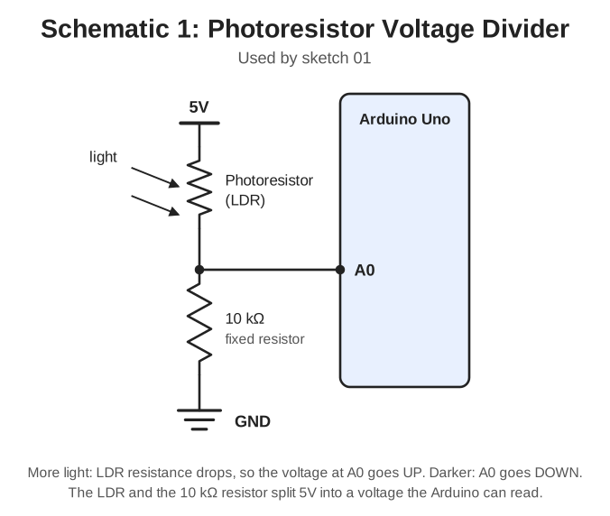
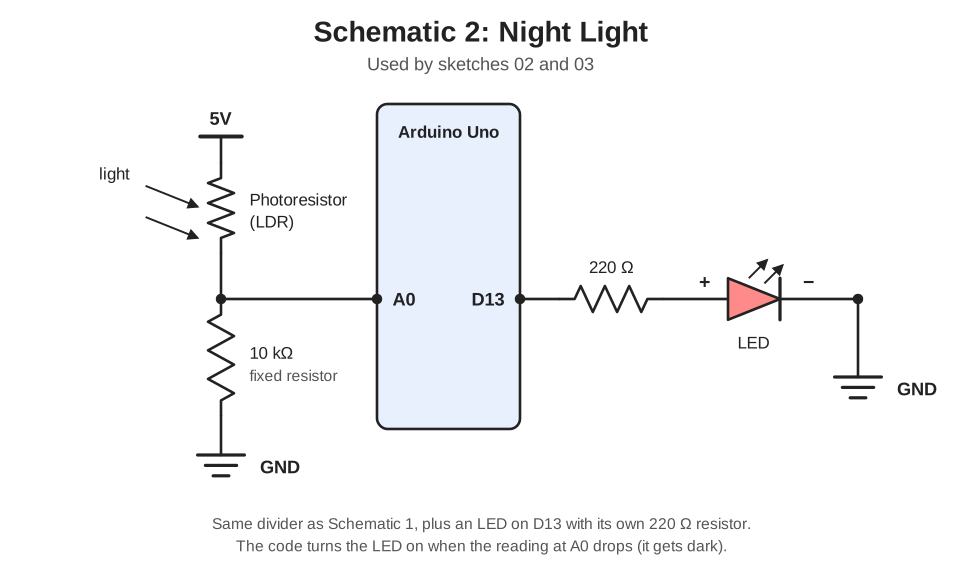
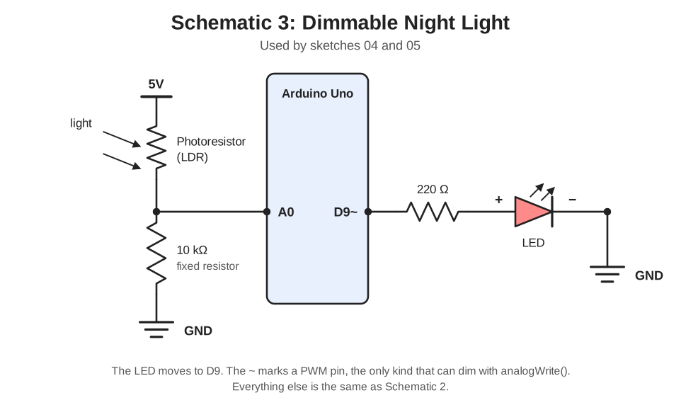
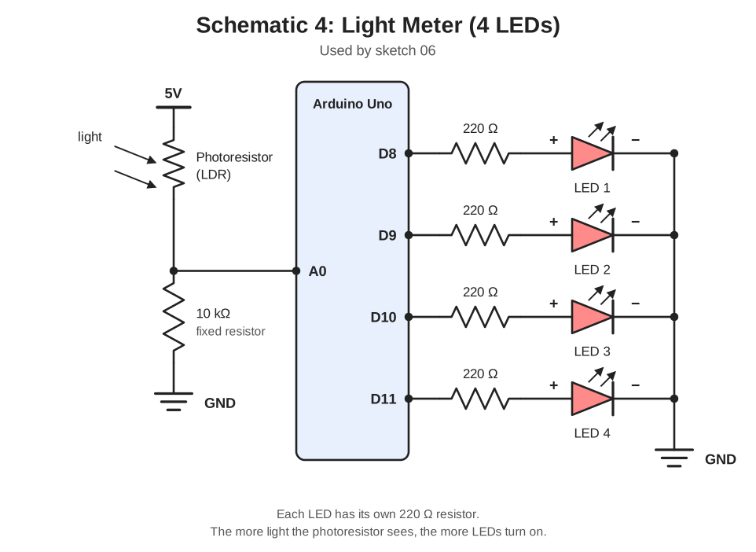

# Project 03: Night Light

So far your Arduino has only understood ON and OFF. Now it will measure *how much* of something there is. You'll read a photoresistor (a light sensor) and build a night light that turns on when the room gets dark.

**Time:** 60-90 minutes | **Difficulty:** Beginner | **Cost:** about $2 more than Project 02 (free in Tinkercad)

## What You'll Learn

- Analog input with `analogRead()` (values from 0 to 1023)
- How a photoresistor (LDR) works
- Voltage dividers, one of the most useful circuits in electronics
- Choosing thresholds and avoiding flicker with hysteresis
- PWM dimming with `analogWrite()`
- `map()` and `constrain()`
- Auto-calibration, so your code adapts to the room

## Parts List

| Part | Qty | Approx. cost |
|------|-----|--------------|
| Arduino Uno | 1 | (from Project 01) |
| Breadboard | 1 | (from Project 01) |
| LEDs | 4 | (from Project 01) |
| 220 Ω resistors | 4 | (from Project 01) |
| 10 kΩ resistor | 1 | (from Project 02) |
| Photoresistor (LDR) | 1 | $1 |
| Jumper wires | ~12 | $3 |

## Digital vs Analog

| | Digital (Projects 01-02) | Analog (this project) |
|--|--------------------------|-----------------------|
| Values | Only HIGH or LOW | A whole range of voltages |
| Read with | `digitalRead()` | `analogRead()` |
| Result | 0 or 1 | 0 to 1023 (0 V to 5 V) |
| Pins | D0-D13 | A0-A5 |

## How the Photoresistor Works

A photoresistor is a resistor whose resistance changes with light:

- **Bright light:** low resistance
- **Darkness:** high resistance

The Arduino can't measure resistance directly. It measures *voltage*. So we pair the photoresistor with a fixed 10 kΩ resistor to make a **voltage divider**. This splits the 5 V between the two parts, and the voltage at the middle point (connected to A0) changes with the light:

| Room | LDR resistance | Voltage at A0 | `analogRead()` |
|------|----------------|---------------|----------------|
| Bright | low | higher | bigger number |
| Dark | high | lower | smaller number |

The exact numbers depend on your sensor and your room, which is why sketch 01 exists. Run it first.

> **Tinkercad tip:** click the photoresistor while the simulation is running and a light slider appears. Drag it to simulate day and night.

## Schematics

Each schematic sits in the sketch folder where the circuit first changes. Sketches that reuse a circuit don't get their own copy.

| Circuit | Schematic is in | Used by sketches |
|---------|-----------------|------------------|
| Photoresistor voltage divider | [`01_read_light`](01_read_light/) | 01 |
| Night light (divider + LED on D13) | [`02_night_light_basic`](02_night_light_basic/) | 02, 03 |
| Dimmable night light (LED on D9) | [`04_night_light_dimmer`](04_night_light_dimmer/) | 04, 05 |
| Light meter (divider + 4 LEDs) | [`06_light_meter`](06_light_meter/) | 06 |

### Circuit 1: photoresistor voltage divider (sketch 01)

### Circuit 2: night light (sketches 02, 03)

### Circuit 3: dimmable night light (sketches 04, 05)

### Circuit 4: light meter (sketch 06)

## Pin Summary

| Sketch | Sensor pin | LED pin(s) |
|--------|------------|------------|
| 01 | A0 | none |
| 02, 03 | A0 | 13 |
| 04, 05 | A0 | 9 (PWM) |
| 06 | A0 | 8, 9, 10, 11 |

## The Sketches

Do these in order. Each one builds on the last.

| File | What it does | New idea |
|------|--------------|----------|
| [`01_read_light`](01_read_light/01_read_light.ino) | Prints the light level to the Serial Monitor | `analogRead`, voltage divider, converting to volts |
| [`02_night_light_basic`](02_night_light_basic/02_night_light_basic.ino) | LED turns on when it gets dark | Thresholds |
| [`03_night_light_hysteresis`](03_night_light_hysteresis/03_night_light_hysteresis.ino) | Same, but without flickering at the edge | Hysteresis (two thresholds) |
| [`04_night_light_dimmer`](04_night_light_dimmer/04_night_light_dimmer.ino) | LED gets brighter as the room gets darker | PWM, `analogWrite`, `map`, `constrain` |
| [`05_auto_calibrate`](05_auto_calibrate/05_auto_calibrate.ino) | Measures the room's darkest and brightest at startup | Calibration with `millis()` |
| [`06_light_meter`](06_light_meter/06_light_meter.ino) | 4 LEDs show how bright the room is | Bar graph with a `for` loop |

## How to Run in Tinkercad

1. Create a new Circuit and add an Arduino Uno, breadboard, photoresistor, a 10 kΩ resistor, and LED(s) with 220 Ω resistors.
2. Wire it up using the matching schematic.
3. Click **Code**, switch to **Text**, and paste in a sketch.
4. Click **Start Simulation**, then click the photoresistor and drag its light slider.
5. For sketches 01 and 05, open the **Serial Monitor** to see the numbers.

## Common Mistakes

- **LED never turns on (sketch 02):** your threshold doesn't match your readings. Run sketch 01 and pick a number between your bright and dark values.
- **Behavior is backwards (LED on when bright):** the photoresistor and the 10 kΩ resistor are swapped. The photoresistor goes between 5V and A0, and the resistor between A0 and GND.
- **Reading is always 0 or always 1023:** the sensor or resistor isn't connected to the A0 row. Check that both parts and the wire to A0 share the same breadboard row.
- **LED flickers in dim light:** use sketch 03's hysteresis.
- **LED won't dim (sketch 04):** the LED must be on a PWM pin (marked ~). Pin 13 can't dim.
- **Calibration gives a tiny range (sketch 05):** you didn't change the light during the 5 seconds. Cover and uncover the sensor while the LED is lit.

## Challenges

1. Add a button from Project 02 that turns the night light off completely.
2. Make the LED slowly fade on and off instead of switching instantly.
3. In sketch 06, make the meter work in reverse: more LEDs when it's *darker*.
4. Add a buzzer that beeps when the room gets very bright.
5. Print the light level as a simple text bar in the Serial Monitor, like `#####`.

## Next Project

Next up: temperature and humidity sensors with an LCD display. Coming soon in Project 04.
